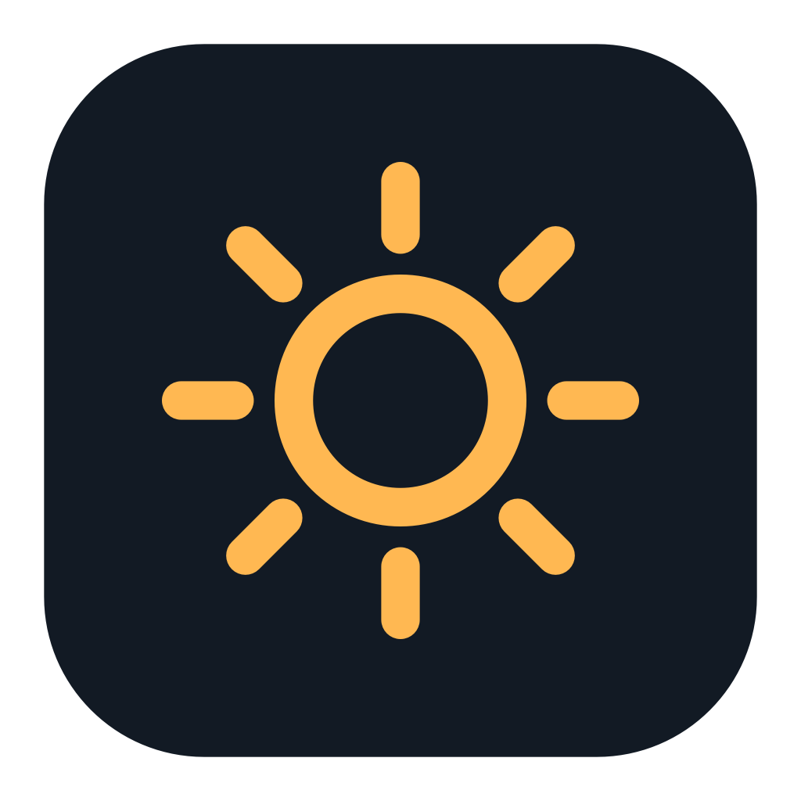
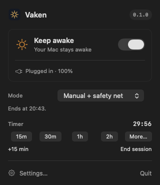
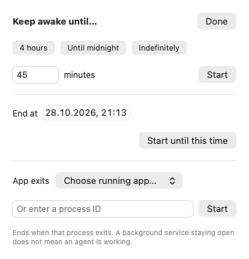
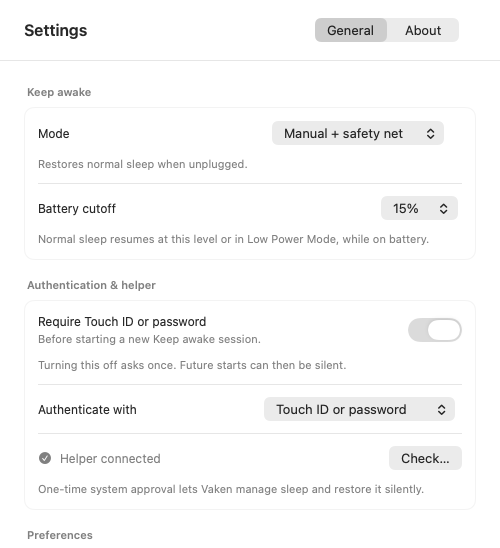
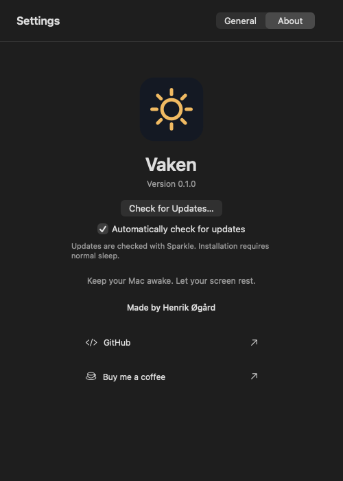

# Vaken

Keep your Mac awake. Let your screen rest.



Vaken is a native macOS menu-bar app for keeping a Mac reachable during remote work, builds and other long-running tasks. It controls system sleep separately from display sleep and screen locking.

**[Download Vaken.dmg](https://github.com/henrikogaard/vaken/releases/latest/download/Vaken.dmg)** · [All releases](https://github.com/henrikogaard/vaken/releases)



## Features

- One Keep awake switch, with an outline sun for On and crescent moon for Off.
- Manual, Follow power source, and Manual + safety net modes, selectable from the dropdown.
- Quick timers, countdown, +15 minutes, custom durations and clock deadlines.
- Sessions that end when a selected application or process exits.
- Battery cutoff and Low Power Mode protection; optional display-awake control.
- Native Touch ID or password authentication, with an explicit opt-out for future starts.
- Configurable global shortcut, launch at login and state notifications.
- Sparkle update checks with user-controlled installation.

## Requirements and installation

Requires **macOS 13 or later on Apple Silicon**. Intel and universal distributions have not been verified.

1. Download **Vaken.dmg** from [Releases](https://github.com/henrikogaard/vaken/releases).
2. Open the disk image and drag **Vaken.app** onto the **Applications** shortcut inside it.
3. Eject the disk image, then open **Vaken** from Applications. Do not run it directly from the image: the helper needs a stable app location.
4. Click Vaken's moon icon in the menu bar and choose **Set up helper…**.
5. Complete any macOS approval in **System Settings → General → Login Items & Extensions**. Wait for **Helper connected**, then turn on **Keep awake**.

If an older copy is running, end its session and quit it before replacing the app. Keep only the intended installed copy running.

Release apps and disk images are Developer ID signed, notarized and stapled. The ZIP remains available for Sparkle updates and manual installation.

Setup uses a signed system helper. No Terminal step or global sudo/PAM changes are required.

## Using Vaken

### Start and stop

Click the menu-bar icon and turn **Keep awake** On. Authenticate with Touch ID or password when asked. The outline sun means system sleep is disabled; the crescent moon means normal sleep is allowed. Your screen can still sleep and lock as usual.

The main switch starts an indefinite session. Turn it Off or choose **End session** to cancel the session and restore normal sleep. Quitting Vaken also restores normal sleep; if restoration fails, Vaken stays open and shows an error. If Keep awake was on when Vaken quit or the Mac restarted, Vaken turns it on again the next time it opens, keeping any remaining time limit. Turn on **Launch at login** for this to work after a restart. It asks for Touch ID or password first when that is required. Sessions that end with an app, sessions whose time ran out and Follow power source mode are not resumed. Until Vaken opens again, normal sleep applies.

### Choose a mode

The **Mode** dropdown is available directly in the menu and in Settings.

| Mode | Use it when | Behavior |
|---|---|---|
| Manual + safety net | You want manual control while plugged in | Default. You start the session; unplugging restores normal sleep |
| Follow power source | You want power-connected automation | Enables on AC; restores sleep on battery |
| Manual | You need an explicit session on either power source | You choose when it ends; battery cutoff and Low Power Mode protection still apply |

Manual Off and timer/process completion pause Follow until the power source changes or you explicitly turn Keep awake on again. This lets a session actually end instead of immediately restarting.

### Set a timer or follow a process

Choose **15m**, **30m**, **1h** or **2h** in the dropdown to start a timed session. The countdown shows the time remaining, and **+15 min** extends it. Changing a timer while already awake does not ask for authentication again.

Open **More…** for longer presets, custom minutes, a clock deadline, a running application or a PID. A process-linked session ends when that specific process exits, even if its PID is later reused.



An app remaining open is not proof that a background job is active. Select the actual build/download process when that distinction matters.

### Configure authentication and safety

Open **Settings…** for the battery cutoff, authentication, display control, login preference, notifications and global shortcut.



- **Require Touch ID or password** is On by default. Turn it Off and authenticate once to allow future new sessions to start silently. Turning it back On restores prompting. Restoring sleep is always prompt-free.
- **Battery cutoff** defaults to 15% and is adjustable between 5% and 50%. On battery, reaching that level or enabling Low Power Mode ends the session in every mode.
- **Keep display awake** is Off by default. Enable it only when the display itself must remain on; it does not unlock the screen.
- **Keyboard shortcut** records Command or Control plus another modifier. Conflicts are reported. Launch at login and state notifications use the corresponding macOS permissions.

If the authentication switch is disabled, check the helper status. An older helper needs **Update…** after the current session ends. If registration fails and Setup is offered again, retry Setup rather than changing system files.

### Check for updates

Open **Settings → About → Check for Updates…**, or use the dropdown's manual check. Sparkle asks permission for automatic checks and preserves that choice.



End Keep awake before installing an update. Vaken does not restart unattended, and an update offer temporarily blocks new sessions until it is finished or dismissed. Local development builds without a feed/key show **Updates are not configured** and make no updater requests.

Screenshots show Vaken 0.1.0 native views with demonstration session data. The Settings screenshot is cropped to the mode and authentication controls. See the [full user guide](docs/user-guide.md) for troubleshooting and removal.

## Safety and privacy

Vaken changes the system-wide `SleepDisabled` flag. It does not disable thermal protections, unlock the screen or simulate user activity. Do not leave a running Mac in a bag or another poorly ventilated space. Hardware, macOS and helper failures can still interrupt remote access; recovery is not guaranteed in every failure mode.

The helper owns session deadlines, battery policy and a heartbeat lease. Quitting normally waits for verified sleep restoration. If manual recovery is needed:

```sh
sudo /usr/bin/pmset -a disablesleep 0
```

Vaken adds no analytics. Configured update checks contact the feed host; see [security and privacy](docs/security.md).

## Build

Use a macOS Swift toolchain supporting Swift tools 5.9 or later. SwiftPM resolves the pinned Sparkle binary dependency. Helper-enabled packaging requires the configured Developer ID identity; ad-hoc signing is not supported for the trusted helper connection.

```sh
swift test
sh scripts/make-app.sh
```

The bundle is written to `build/Vaken.app`. Local building does not install the helper, publish a release or change the installed app. Approved stable `v*` tags use GitHub Actions to sign, notarize and prepare a draft release; publishing remains manual. The initial release workflow targets Apple Silicon. See [development](docs/development.md) and [release preparation](docs/releases.md) for configuration and signing requirements.

## Documentation

- [Documentation index](docs/README.md)
- [User guide and troubleshooting](docs/user-guide.md)
- [System design](docs/design/vaken.md)
- [Development](docs/development.md)
- [Security and privacy](docs/security.md)
- [Releases and Sparkle](docs/releases.md)

## License and author

[MIT](LICENSE). Copyright © 2026 Henrik Øgård.

[GitHub](https://github.com/henrikogaard) · [Buy me a coffee](https://buymeacoffee.com/henrikogaard)

Sparkle and its bundled components retain their own licenses. See [third-party notices](THIRD_PARTY_NOTICES.md).
